<div align="center">


# Pulso

**Entiende cómo trabaja tu equipo con IA, sin vigilarlo.**

App de escritorio para registrar tiempo y actividad, gestionar tareas y generar reportes con IA a partir de cifras calculadas.


</div>

## Acerca del proyecto

Pulso es una aplicación de escritorio para **equipos pequeños que trabajan con herramientas de IA** y para sus líderes.
Registra en qué se usa el tiempo, organiza proyectos y tareas, y genera reportes en lenguaje natural cuyas cifras salen
de SQL, no de la IA.

- **Privacidad primero:** los títulos de ventana nunca salen del equipo y se guardan cifrados. Nunca se registran
  teclas, capturas de pantalla ni contenido de documentos o de chats.
- **Las cifras salen de SQL:** la IA solo redacta y solo puede citar cifras ya calculadas.
- **Permisos en la base de datos:** cada regla de rol vive en una política RLS de Postgres con su prueba.

## Funcionalidades

- **Mi día, semana y mes:** sensor de actividad (app activa, título e inactividad cada 2 s), clasificación por
  categorías y detección de uso de IA, temporizador por tarea, descansos, pausa de privacidad con tope del equipo y
  registro manual de tiempo. Funciona sin conexión.
- **Cuentas y equipos:** registro, invitaciones con código, roles `owner`, `admin`, `member` y `viewer`, consentimiento
  versionado, auditoría y eliminar mi cuenta.
- **Sincronización:** cada 60 s y al volver la red; sube bloques y entradas **sin títulos de ventana**.
- **Proyectos y tareas:** responsables, apoyos, subtareas, lista y tablero kanban, y revisión con evidencias al estilo
  de un *pull request*.
- **Reportes con IA:** personal, de proyecto y de equipo, en tres modos (*Gratis*, *Clave propia* y *Manual*), con un
  validador que rechaza cifras o hechos inventados. Exporta a Markdown, JSON, CSV y PDF.
- **Panel del equipo** según el rol, presencia, reglas por app, sitios no permitidos y exportar mis datos.
- Interfaz en español e inglés.

Detalle por funcionalidad en [`docs/FUNCIONALIDADES.md`](docs/FUNCIONALIDADES.md).

## Así se ve

Recorrido por la aplicación de escritorio con un equipo de demostración de cuatro personas y tres semanas de actividad de ejemplo. Las capturas siguen el tema de GitHub: con el tema oscuro ves la versión oscura. Cada imagen se abre a tamaño completo; están en [`docs/capturas/`](docs/capturas/) (claro) y [`docs/capturas/oscuro/`](docs/capturas/oscuro/).

<details open>
<summary><b>Cuenta, invitaciones y consentimiento</b></summary>

<table>
  <tr><td width="50%"><a href="docs/capturas/01-acceso.png"><picture><source media="(prefers-color-scheme: dark)" srcset="docs/capturas/oscuro/01-acceso.png" /></picture></a><br /><sub>Iniciar sesión</sub></td><td width="50%"><a href="docs/capturas/02-registro.png"><picture><source media="(prefers-color-scheme: dark)" srcset="docs/capturas/oscuro/02-registro.png" /></picture></a><br /><sub>Crear cuenta</sub></td></tr>
  <tr><td width="50%"><a href="docs/capturas/55-recuperar-contrasena.png"><picture><source media="(prefers-color-scheme: dark)" srcset="docs/capturas/oscuro/55-recuperar-contrasena.png" /></picture></a><br /><sub>Recuperar la contraseña con un código</sub></td><td width="50%"><a href="docs/capturas/03-bienvenida.png"><picture><source media="(prefers-color-scheme: dark)" srcset="docs/capturas/oscuro/03-bienvenida.png" /></picture></a><br /><sub>Bienvenida: crear un equipo o unirse</sub></td></tr>
  <tr><td width="50%"><a href="docs/capturas/04-consentimiento.png"><picture><source media="(prefers-color-scheme: dark)" srcset="docs/capturas/oscuro/04-consentimiento.png" /></picture></a><br /><sub>Consentimiento antes de compartir datos</sub></td><td width="50%"><a href="docs/capturas/24-invitacion-recibida.png"><picture><source media="(prefers-color-scheme: dark)" srcset="docs/capturas/oscuro/24-invitacion-recibida.png" /></picture></a><br /><sub>Invitación recibida al entrar</sub></td></tr>
  <tr><td width="50%"><a href="docs/capturas/34-invitacion-responder.png"><picture><source media="(prefers-color-scheme: dark)" srcset="docs/capturas/oscuro/34-invitacion-responder.png" /></picture></a><br /><sub>Responder la invitación</sub></td><td width="50%"><a href="docs/capturas/35-invitacion-aceptar.png"><picture><source media="(prefers-color-scheme: dark)" srcset="docs/capturas/oscuro/35-invitacion-aceptar.png" /></picture></a><br /><sub>Aceptar con el código y el consentimiento</sub></td></tr>
</table>

</details>

<details open>
<summary><b>Mi día: actividad, temporizador, descansos y pausa</b></summary>

<table>
  <tr><td width="50%"><a href="docs/capturas/11-mi-dia-temporizador.png"><picture><source media="(prefers-color-scheme: dark)" srcset="docs/capturas/oscuro/11-mi-dia-temporizador.png" /></picture></a><br /><sub>Mi día con el temporizador en marcha</sub></td><td width="50%"><a href="docs/capturas/12-mi-dia-semana.png"><picture><source media="(prefers-color-scheme: dark)" srcset="docs/capturas/oscuro/12-mi-dia-semana.png" /></picture></a><br /><sub>Mi semana</sub></td></tr>
  <tr><td width="50%"><a href="docs/capturas/13-mi-dia-mes.png"><picture><source media="(prefers-color-scheme: dark)" srcset="docs/capturas/oscuro/13-mi-dia-mes.png" /></picture></a><br /><sub>Mi mes</sub></td><td width="50%"><a href="docs/capturas/14-mi-dia-por-app.png"><picture><source media="(prefers-color-scheme: dark)" srcset="docs/capturas/oscuro/14-mi-dia-por-app.png" /></picture></a><br /><sub>Tiempo por app y herramientas de IA</sub></td></tr>
  <tr><td width="50%"><a href="docs/capturas/43-mi-dia-por-sitio.png"><picture><source media="(prefers-color-scheme: dark)" srcset="docs/capturas/oscuro/43-mi-dia-por-sitio.png" /></picture></a><br /><sub>Tiempo por sitio web (solo el dominio)</sub></td><td width="50%"><a href="docs/capturas/15-mi-dia-linea.png"><picture><source media="(prefers-color-scheme: dark)" srcset="docs/capturas/oscuro/15-mi-dia-linea.png" /></picture></a><br /><sub>Línea de tiempo del día</sub></td></tr>
  <tr><td width="50%"><a href="docs/capturas/44-mi-dia-detalle.png"><picture><source media="(prefers-color-scheme: dark)" srcset="docs/capturas/oscuro/44-mi-dia-detalle.png" />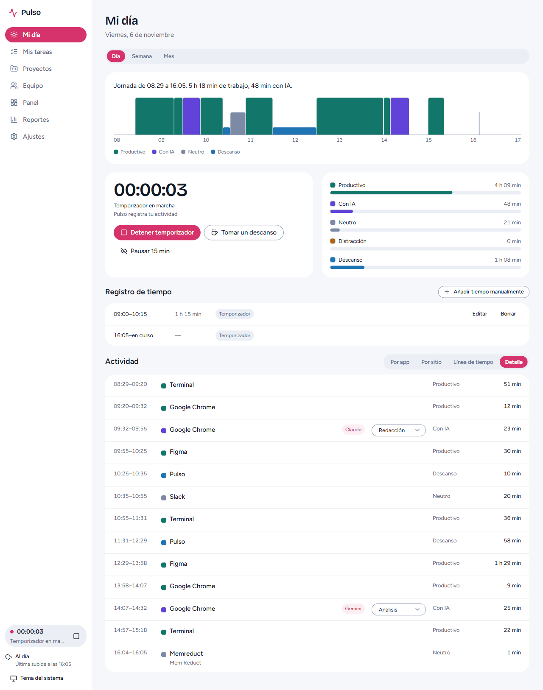</picture></a><br /><sub>Detalle de bloques y tipo de uso de IA</sub></td><td width="50%"><a href="docs/capturas/40-registro-manual.png"><picture><source media="(prefers-color-scheme: dark)" srcset="docs/capturas/oscuro/40-registro-manual.png" /></picture></a><br /><sub>Registro manual de tiempo</sub></td></tr>
  <tr><td width="50%"><a href="docs/capturas/40b-descartar-cambios.png"><picture><source media="(prefers-color-scheme: dark)" srcset="docs/capturas/oscuro/40b-descartar-cambios.png" />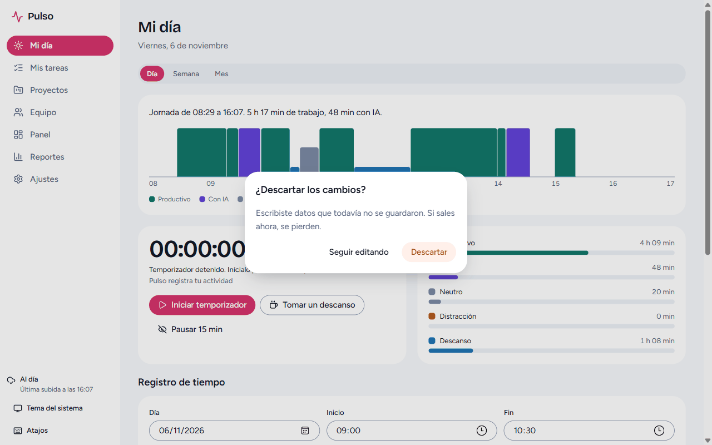</picture></a><br /><sub>Aviso antes de perder cambios sin guardar</sub></td><td width="50%"><a href="docs/capturas/41-descanso.png"><picture><source media="(prefers-color-scheme: dark)" srcset="docs/capturas/oscuro/41-descanso.png" />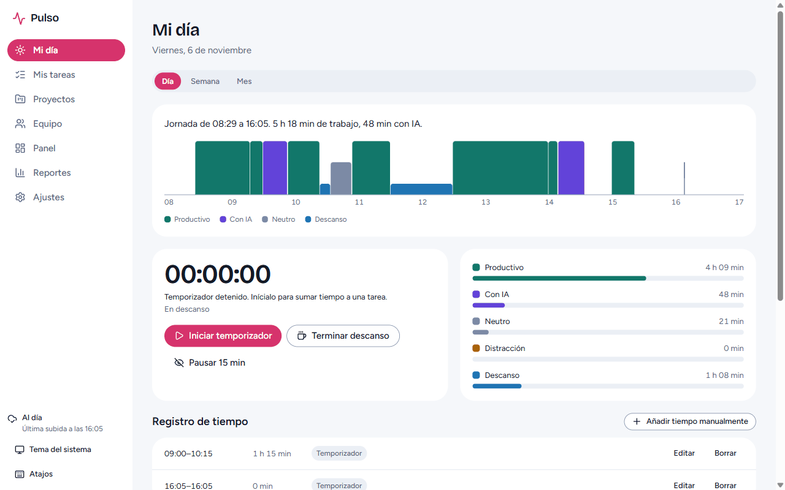</picture></a><br /><sub>Descanso en curso</sub></td></tr>
  <tr><td width="50%"><a href="docs/capturas/42-pausa-privacidad.png"><picture><source media="(prefers-color-scheme: dark)" srcset="docs/capturas/oscuro/42-pausa-privacidad.png" /></picture></a><br /><sub>Pausa de privacidad</sub></td><td width="50%"></td></tr>
</table>

</details>

<details open>
<summary><b>Proyectos, tareas y revisión con evidencias</b></summary>

<table>
  <tr><td width="50%"><a href="docs/capturas/08-proyecto-tablero.png"><picture><source media="(prefers-color-scheme: dark)" srcset="docs/capturas/oscuro/08-proyecto-tablero.png" /></picture></a><br /><sub>Tablero kanban del proyecto</sub></td><td width="50%"><a href="docs/capturas/09-proyecto-lista.png"><picture><source media="(prefers-color-scheme: dark)" srcset="docs/capturas/oscuro/09-proyecto-lista.png" /></picture></a><br /><sub>Lista de tareas</sub></td></tr>
  <tr><td width="50%"><a href="docs/capturas/09b-proyecto-lista-filtrada.png"><picture><source media="(prefers-color-scheme: dark)" srcset="docs/capturas/oscuro/09b-proyecto-lista-filtrada.png" />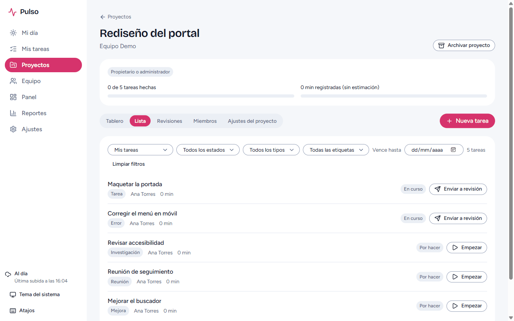</picture></a><br /><sub>Lista filtrada por responsable</sub></td><td width="50%"><a href="docs/capturas/10-tarea.png"><picture><source media="(prefers-color-scheme: dark)" srcset="docs/capturas/oscuro/10-tarea.png" /></picture></a><br /><sub>Detalle de tarea con subtarea</sub></td></tr>
  <tr><td width="50%"><a href="docs/capturas/31-nueva-tarea-evidencia.png"><picture><source media="(prefers-color-scheme: dark)" srcset="docs/capturas/oscuro/31-nueva-tarea-evidencia.png" /></picture></a><br /><sub>Nueva tarea con criterios y evidencia requerida</sub></td><td width="50%"><a href="docs/capturas/29-proyecto-miembros.png"><picture><source media="(prefers-color-scheme: dark)" srcset="docs/capturas/oscuro/29-proyecto-miembros.png" /></picture></a><br /><sub>Miembros del proyecto: líder y colaborador</sub></td></tr>
  <tr><td width="50%"><a href="docs/capturas/30-proyecto-ajustes.png"><picture><source media="(prefers-color-scheme: dark)" srcset="docs/capturas/oscuro/30-proyecto-ajustes.png" /></picture></a><br /><sub>Formulario de entrega configurable</sub></td><td width="50%"><a href="docs/capturas/16-mis-tareas.png"><picture><source media="(prefers-color-scheme: dark)" srcset="docs/capturas/oscuro/16-mis-tareas.png" /></picture></a><br /><sub>Mis tareas</sub></td></tr>
  <tr><td width="50%"><a href="docs/capturas/32-mis-tareas-bea.png"><picture><source media="(prefers-color-scheme: dark)" srcset="docs/capturas/oscuro/32-mis-tareas-bea.png" /></picture></a><br /><sub>Mis tareas de otra persona del equipo</sub></td><td width="50%"><a href="docs/capturas/33-entrega-formulario.png"><picture><source media="(prefers-color-scheme: dark)" srcset="docs/capturas/oscuro/33-entrega-formulario.png" /></picture></a><br /><sub>Enviar a revisión</sub></td></tr>
  <tr><td width="50%"><a href="docs/capturas/33b-entrega-completa.png"><picture><source media="(prefers-color-scheme: dark)" srcset="docs/capturas/oscuro/33b-entrega-completa.png" /></picture></a><br /><sub>Entrega con capturas, documento y enlace</sub></td><td width="50%"><a href="docs/capturas/36-revisiones.png"><picture><source media="(prefers-color-scheme: dark)" srcset="docs/capturas/oscuro/36-revisiones.png" /></picture></a><br /><sub>Revisiones pendientes</sub></td></tr>
  <tr><td width="50%"><a href="docs/capturas/37-revision-detalle.png"><picture><source media="(prefers-color-scheme: dark)" srcset="docs/capturas/oscuro/37-revision-detalle.png" /></picture></a><br /><sub>Revisar la entrega</sub></td><td width="50%"><a href="docs/capturas/56-revision-pedir-cambios.png"><picture><source media="(prefers-color-scheme: dark)" srcset="docs/capturas/oscuro/56-revision-pedir-cambios.png" />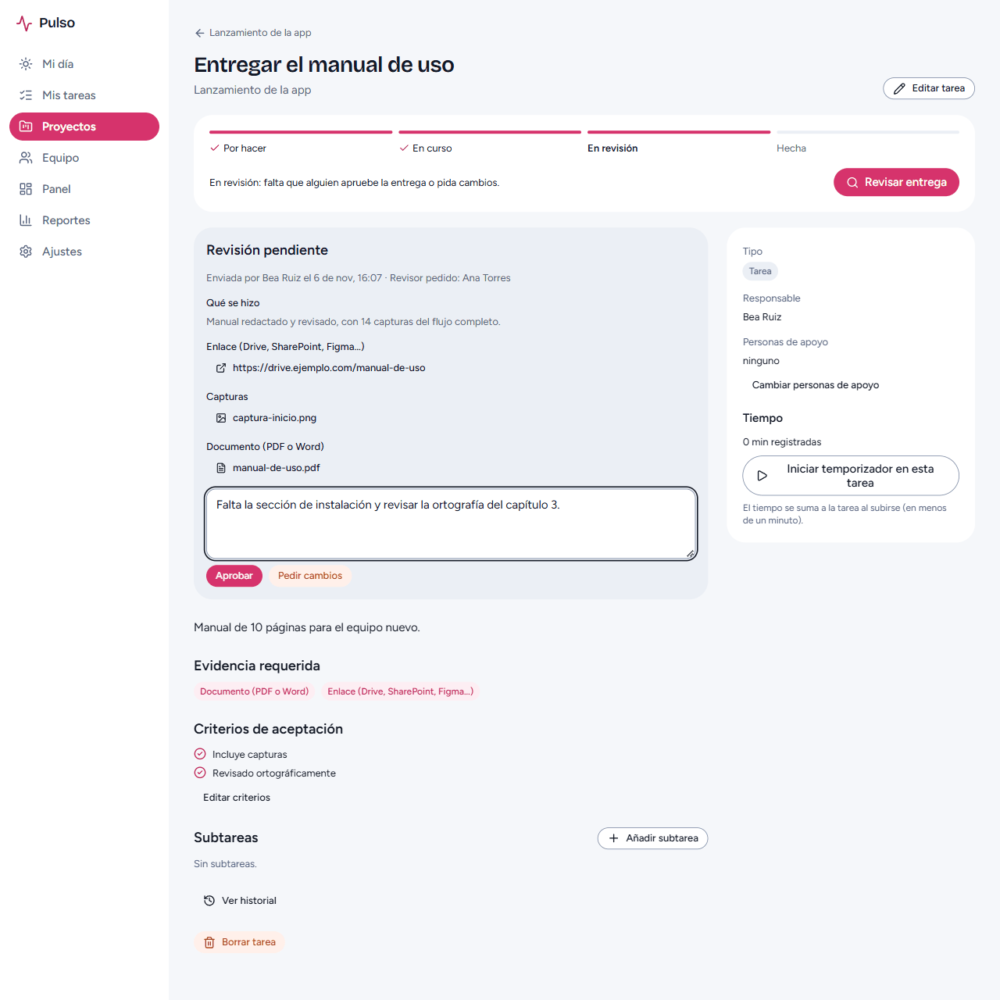</picture></a><br /><sub>Pedir cambios con un comentario</sub></td></tr>
  <tr><td width="50%"><a href="docs/capturas/38-revision-aprobada.png"><picture><source media="(prefers-color-scheme: dark)" srcset="docs/capturas/oscuro/38-revision-aprobada.png" /></picture></a><br /><sub>Entrega aprobada</sub></td><td width="50%"><a href="docs/capturas/39-historial-tarea.png"><picture><source media="(prefers-color-scheme: dark)" srcset="docs/capturas/oscuro/39-historial-tarea.png" /></picture></a><br /><sub>Historial de la tarea</sub></td></tr>
</table>

</details>

<details>
<summary><b>Equipo, roles, reglas y privacidad</b></summary>

<table>
  <tr><td width="50%"><a href="docs/capturas/23-equipo-invitacion.png"><picture><source media="(prefers-color-scheme: dark)" srcset="docs/capturas/oscuro/23-equipo-invitacion.png" /></picture></a><br /><sub>Invitar con un rol y un código</sub></td><td width="50%"><a href="docs/capturas/25-equipo-miembros-roles.png"><picture><source media="(prefers-color-scheme: dark)" srcset="docs/capturas/oscuro/25-equipo-miembros-roles.png" /></picture></a><br /><sub>Miembros y roles</sub></td></tr>
  <tr><td width="50%"><a href="docs/capturas/27-equipo-general.png"><picture><source media="(prefers-color-scheme: dark)" srcset="docs/capturas/oscuro/27-equipo-general.png" /></picture></a><br /><sub>Ajustes del equipo y salir del equipo</sub></td><td width="50%"><a href="docs/capturas/28-equipo-reglas.png"><picture><source media="(prefers-color-scheme: dark)" srcset="docs/capturas/oscuro/28-equipo-reglas.png" /></picture></a><br /><sub>Reglas, sitios no permitidos y apps</sub></td></tr>
  <tr><td width="50%"><a href="docs/capturas/26-equipo-auditoria.png"><picture><source media="(prefers-color-scheme: dark)" srcset="docs/capturas/oscuro/26-equipo-auditoria.png" /></picture></a><br /><sub>Registro de auditoría</sub></td><td width="50%"><a href="docs/capturas/22-privacidad.png"><picture><source media="(prefers-color-scheme: dark)" srcset="docs/capturas/oscuro/22-privacidad.png" /></picture></a><br /><sub>Qué se mide y quién lo ve</sub></td></tr>
  <tr><td width="50%"><a href="docs/capturas/60-equipo-administrador.png"><picture><source media="(prefers-color-scheme: dark)" srcset="docs/capturas/oscuro/60-equipo-administrador.png" />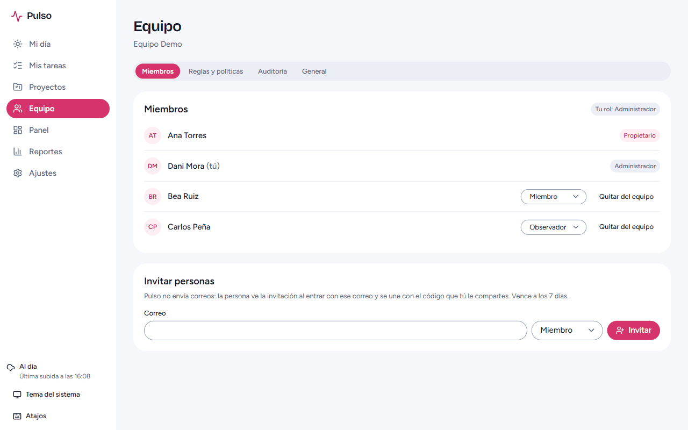</picture></a><br /><sub>Equipo visto por un administrador</sub></td><td width="50%"><a href="docs/capturas/63-equipo-miembro.png"><picture><source media="(prefers-color-scheme: dark)" srcset="docs/capturas/oscuro/63-equipo-miembro.png" />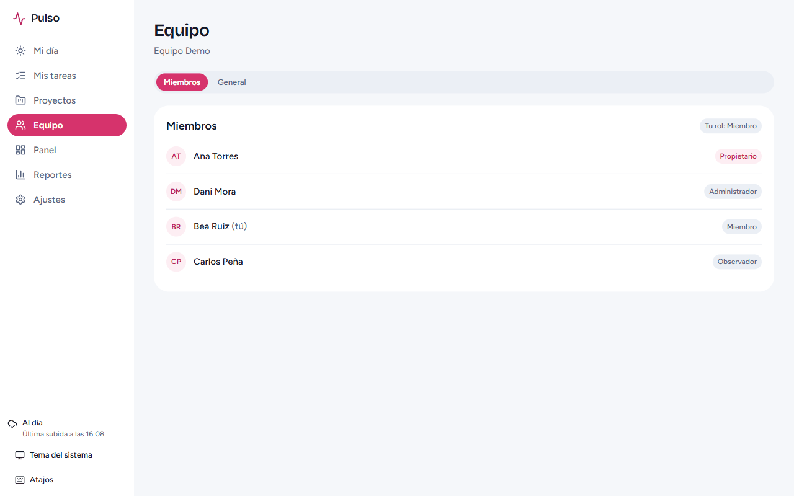</picture></a><br /><sub>Equipo visto por un miembro</sub></td></tr>
  <tr><td width="50%"><a href="docs/capturas/62-equipo-observador.png"><picture><source media="(prefers-color-scheme: dark)" srcset="docs/capturas/oscuro/62-equipo-observador.png" />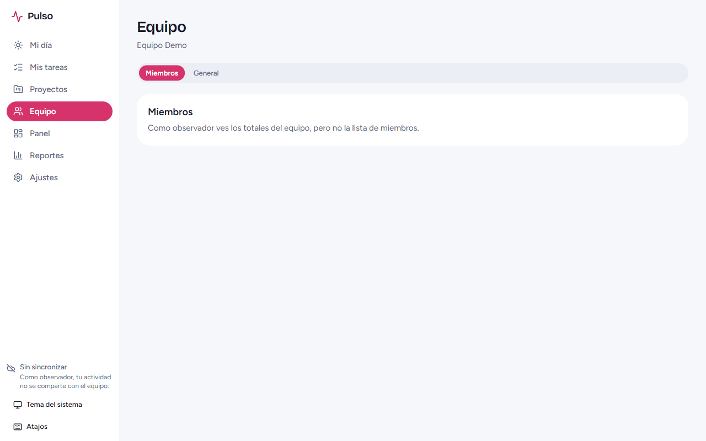</picture></a><br /><sub>Equipo visto por un observador</sub></td><td width="50%"></td></tr>
</table>

</details>

<details>
<summary><b>Panel del equipo y reportes con IA</b></summary>

<table>
  <tr><td width="50%"><a href="docs/capturas/54-panel-equipo.png"><picture><source media="(prefers-color-scheme: dark)" srcset="docs/capturas/oscuro/54-panel-equipo.png" /></picture></a><br /><sub>Panel del equipo: presencia, horas, IA, personas y apps</sub></td><td width="50%"><a href="docs/capturas/59-panel-administrador.png"><picture><source media="(prefers-color-scheme: dark)" srcset="docs/capturas/oscuro/59-panel-administrador.png" />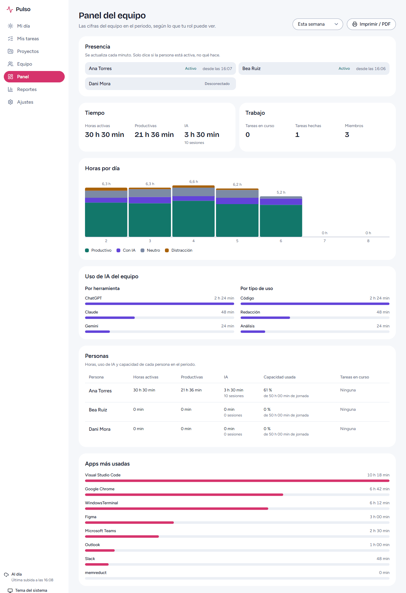</picture></a><br /><sub>Panel visto por un administrador</sub></td></tr>
  <tr><td width="50%"><a href="docs/capturas/61-panel-observador.png"><picture><source media="(prefers-color-scheme: dark)" srcset="docs/capturas/oscuro/61-panel-observador.png" />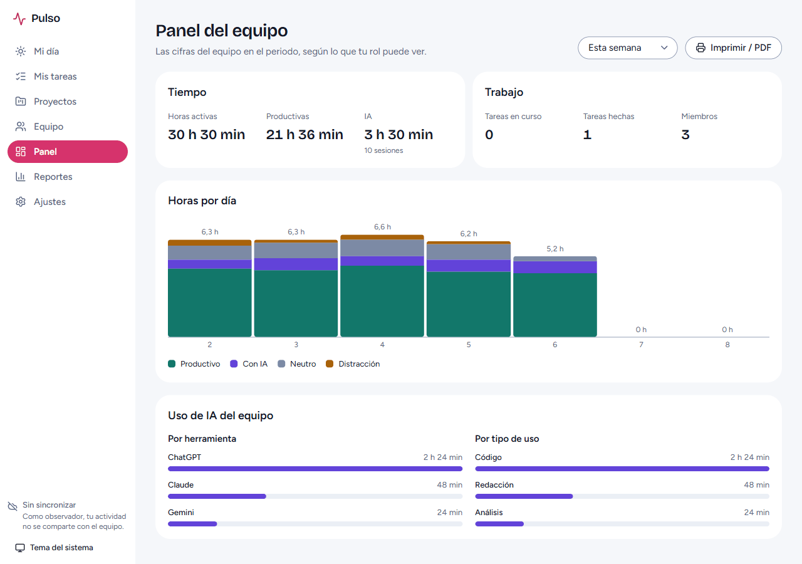</picture></a><br /><sub>Panel visto por un observador: solo totales</sub></td><td width="50%"><a href="docs/capturas/18-reportes.png"><picture><source media="(prefers-color-scheme: dark)" srcset="docs/capturas/oscuro/18-reportes.png" /></picture></a><br /><sub>Reportes: modo Gratis</sub></td></tr>
  <tr><td width="50%"><a href="docs/capturas/45-reportes-clave-propia.png"><picture><source media="(prefers-color-scheme: dark)" srcset="docs/capturas/oscuro/45-reportes-clave-propia.png" /></picture></a><br /><sub>Modo con tu proveedor de IA</sub></td><td width="50%"><a href="docs/capturas/46-reportes-manual.png"><picture><source media="(prefers-color-scheme: dark)" srcset="docs/capturas/oscuro/46-reportes-manual.png" /></picture></a><br /><sub>Modo Manual: copiar el prompt y pegar la respuesta</sub></td></tr>
  <tr><td width="50%"><a href="docs/capturas/47-reportes-equipo.png"><picture><source media="(prefers-color-scheme: dark)" srcset="docs/capturas/oscuro/47-reportes-equipo.png" /></picture></a><br /><sub>Reporte de todo el equipo</sub></td><td width="50%"></td></tr>
</table>

</details>

<details>
<summary><b>Ajustes y datos</b></summary>

<table>
  <tr><td width="50%"><a href="docs/capturas/19-ajustes.png"><picture><source media="(prefers-color-scheme: dark)" srcset="docs/capturas/oscuro/19-ajustes.png" /></picture></a><br /><sub>Ajustes: perfil y zona horaria</sub></td><td width="50%"><a href="docs/capturas/48-ajustes-completo.png"><picture><source media="(prefers-color-scheme: dark)" srcset="docs/capturas/oscuro/48-ajustes-completo.png" /></picture></a><br /><sub>Todos los ajustes</sub></td></tr>
  <tr><td width="50%"><a href="docs/capturas/49-eliminar-cuenta.png"><picture><source media="(prefers-color-scheme: dark)" srcset="docs/capturas/oscuro/49-eliminar-cuenta.png" /></picture></a><br /><sub>Eliminar mi cuenta</sub></td><td width="50%"><a href="docs/capturas/21-atajos.png"><picture><source media="(prefers-color-scheme: dark)" srcset="docs/capturas/oscuro/21-atajos.png" /></picture></a><br /><sub>Atajos de teclado</sub></td></tr>
</table>

</details>

<details>
<summary><b>Idioma y tamaños de ventana</b></summary>

<table>
  <tr><td width="50%"><a href="docs/capturas/50-ingles.png"><picture><source media="(prefers-color-scheme: dark)" srcset="docs/capturas/oscuro/50-ingles.png" /></picture></a><br /><sub>La app en inglés</sub></td><td width="50%"><a href="docs/capturas/51-ancho-medio.png"><picture><source media="(prefers-color-scheme: dark)" srcset="docs/capturas/oscuro/51-ancho-medio.png" /></picture></a><br /><sub>Ventana mediana</sub></td></tr>
  <tr><td width="50%"><a href="docs/capturas/52-ancho-estrecho.png"><picture><source media="(prefers-color-scheme: dark)" srcset="docs/capturas/oscuro/52-ancho-estrecho.png" /></picture></a><br /><sub>Ventana estrecha con barra inferior</sub></td><td width="50%"></td></tr>
</table>

</details>

<details>
<summary><b>Tema oscuro</b></summary>

<table>
  <tr><td width="50%"><a href="docs/capturas/oscuro/11-mi-dia-temporizador.png">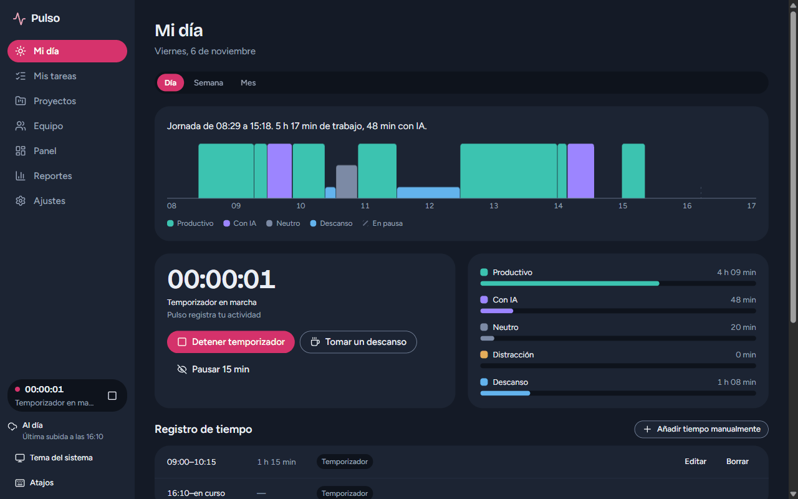</a><br /><sub>Mi día</sub></td><td width="50%"><a href="docs/capturas/oscuro/12-mi-dia-semana.png">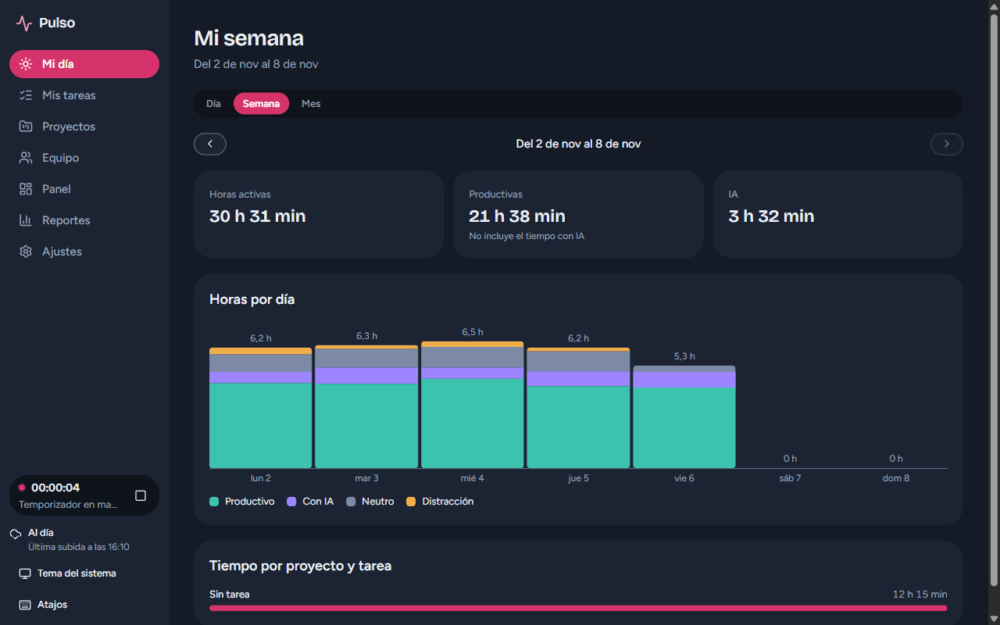</a><br /><sub>Mi semana</sub></td></tr>
  <tr><td width="50%"><a href="docs/capturas/oscuro/08-proyecto-tablero.png">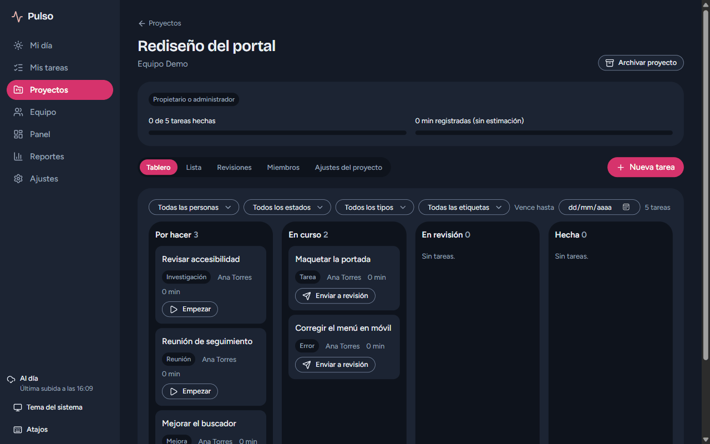</a><br /><sub>Tablero del proyecto</sub></td><td width="50%"><a href="docs/capturas/oscuro/37-revision-detalle.png">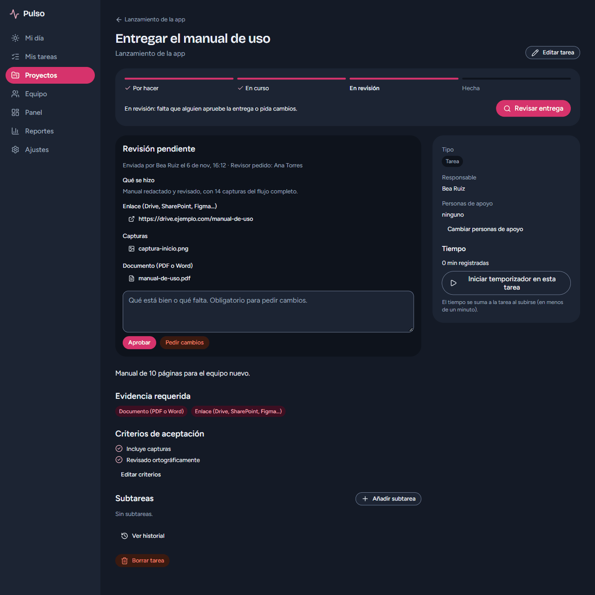</a><br /><sub>Revisar la entrega</sub></td></tr>
  <tr><td width="50%"><a href="docs/capturas/oscuro/54-panel-equipo.png">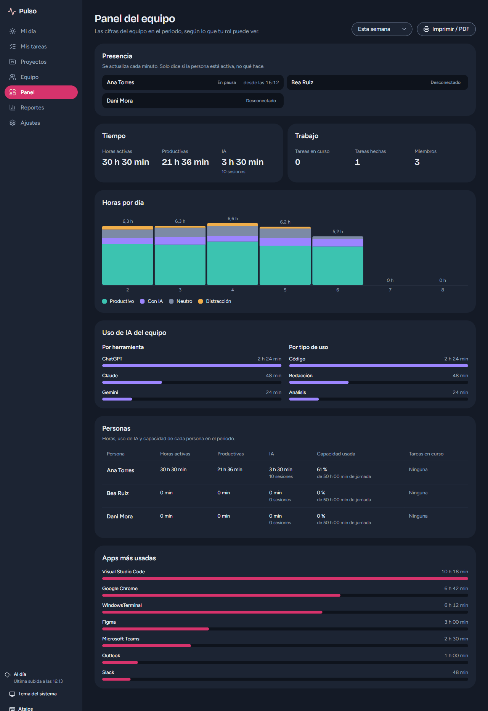</a><br /><sub>Panel del equipo</sub></td><td width="50%"><a href="docs/capturas/oscuro/28-equipo-reglas.png">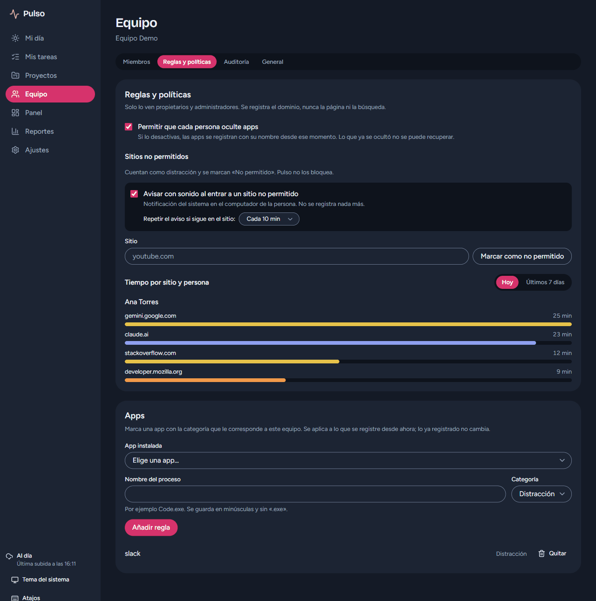</a><br /><sub>Reglas y políticas</sub></td></tr>
  <tr><td width="50%"><a href="docs/capturas/oscuro/01-acceso.png">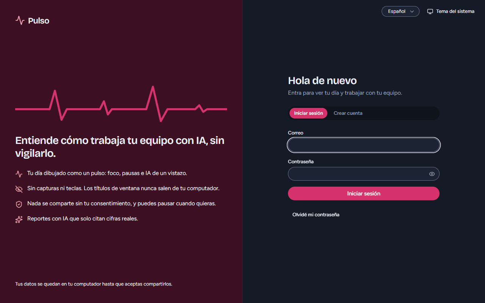</a><br /><sub>Iniciar sesión</sub></td><td width="50%"><a href="docs/capturas/oscuro/52-ancho-estrecho.png">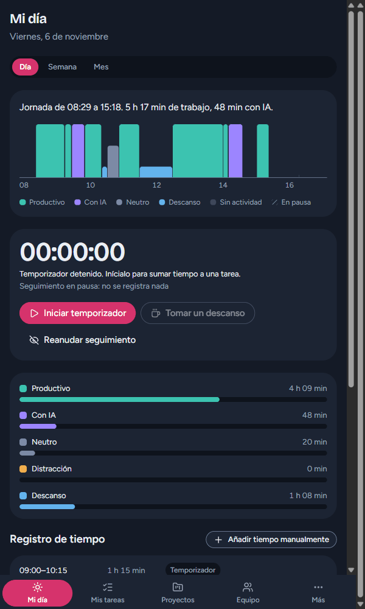</a><br /><sub>Ventana estrecha</sub></td></tr>
</table>

</details>

## Instalación

### [⬇ Descargar Pulso](https://github.com/StehvenObandoUcc/app-escritorio/releases/latest)

Elige el archivo de tu sistema. Los instaladores no están firmados con certificado de código.

| Sistema | Archivo | Primera vez |
|---|---|---|
| Windows 10/11 | `Pulso_<versión>_x64-setup.exe` o `.msi` | SmartScreen: «Más información» → «Ejecutar de todas formas» |
| macOS (Apple Silicon e Intel) | `Pulso_<versión>_universal.dmg` | Clic derecho sobre Pulso → «Abrir» (o `xattr -cr /Applications/Pulso.app`). Para ver títulos de ventana, da el permiso «Grabación de pantalla» |
| Linux | `.deb`, `.rpm` o `.AppImage` | Requiere un almacén de claves (gnome-keyring o KWallet) |

## Arquitectura

Un solo repositorio con una interfaz React y un **núcleo Rust delgado**. La interfaz no ejecuta SQL ni ve secretos:
habla con Rust solo a través del **puente** (`src/bridge/contract.ts`), validado con Zod.

```
┌──────────────── Pulso (app de escritorio, Tauri v2) ────────────────┐
│  Núcleo Rust                       Interfaz React + TypeScript      │
│   sensor ─► SQLite local (títulos   pages ─► bridge (contrato+zod)  │
│   cifrados) · crypto · secrets       sync: pendientes sin títulos   │
│   ai_chat (clave propia)             ─► supabase-js                 │
└───────────────────────────────┬─────────────────────────────────────┘
                                │ HTTPS con el JWT del usuario
┌───────────────────────────────▼─────────────────────────────────────┐
│  Supabase: Auth · Postgres + RLS · funciones SQL · Edge Functions    │
│  ai-trial (modo Gratis) y delete-account                             │
└──────────────────────────────────────────────────────────────────────┘
```

| Capa | Tecnología |
|---|---|
| Escritorio | Tauri 2 · Rust (edición 2024) · SQLite · AES-256-GCM · almacén seguro del sistema |
| Interfaz | React 19 · TypeScript · Tailwind CSS 4 · React Router · TanStack Query · Zod |
| Backend | Supabase (Auth, Postgres con RLS, Edge Functions) |
| Pruebas | Vitest · Testing Library · PGlite (Postgres en memoria) · pruebas de Rust |

## Desarrollo

Requisitos: Node.js 22+, Git y, para la app de escritorio, [Rust](https://rustup.rs) con las dependencias de Tauri
de tu sistema (en Windows, las *Microsoft C++ Build Tools*).

```bash
git clone https://github.com/StehvenObandoUcc/app-escritorio.git
cd app-escritorio
npm install
cp .env.example .env   # VITE_BRIDGE, VITE_SUPABASE_URL y VITE_SUPABASE_ANON_KEY
npm run dev            # interfaz en el navegador con datos de ejemplo (http://localhost:1420)
npm run tauri dev      # app de escritorio real
```

| Comando | Qué hace |
|---|---|
| `npm run verify` | Lint, tipos, tokens de diseño, textos i18n y todas las pruebas |
| `npm run verify:rust` | Clippy y pruebas del núcleo Rust |
| `npm run test:db` | Solo las pruebas de permisos (Postgres en memoria, sin Docker) |
| `npm run db:push` | Aplica las migraciones al proyecto de Supabase enlazado |
| `npm run tauri build` | Genera el instalador del sistema donde se ejecuta |

Las versiones publicadas las genera `.github/workflows/release.yml` al subir una etiqueta `v*`, para Windows, macOS y
Linux. Nunca pongas en `.env` la clave `service_role` ni una clave de IA.

## Estructura

```
.github/      CI en Windows, macOS y Linux, y publicación de instaladores
docs/         arquitectura, decisiones (ADR), specs, roles, diseño e IA
prompts/      prompt versionado de los reportes
scripts/      comprobaciones de tokens de diseño y de textos i18n
src/          interfaz React: app, bridge, cloud, i18n, lib, pages y ui
src-tauri/    núcleo Rust (Tauri v2): sensor, almacenamiento local y comandos
supabase/     migraciones SQL, pruebas de permisos y Edge Functions
```

## Documentación

| Quiero… | Leo… |
|---|---|
| Ver las funcionalidades | [`docs/FUNCIONALIDADES.md`](docs/FUNCIONALIDADES.md) |
| Entender la arquitectura | [`docs/ARQUITECTURA.md`](docs/ARQUITECTURA.md) y [`docs/adr/`](docs/adr/) |
| Saber quién puede hacer qué | [`docs/ROLES.md`](docs/ROLES.md) |
| Entender la IA y las claves | [`docs/IA.md`](docs/IA.md) |
| Hacer interfaz | [`docs/DISENO.md`](docs/DISENO.md) |
| Comprobar que algo funciona | [`docs/COMO-VERIFICAR.md`](docs/COMO-VERIFICAR.md) |

## Notas de plataforma

- Los instaladores no llevan firma de código: Windows y macOS piden confirmar la apertura la primera vez.
- El plan gratuito de Supabase pausa los proyectos sin uso.
